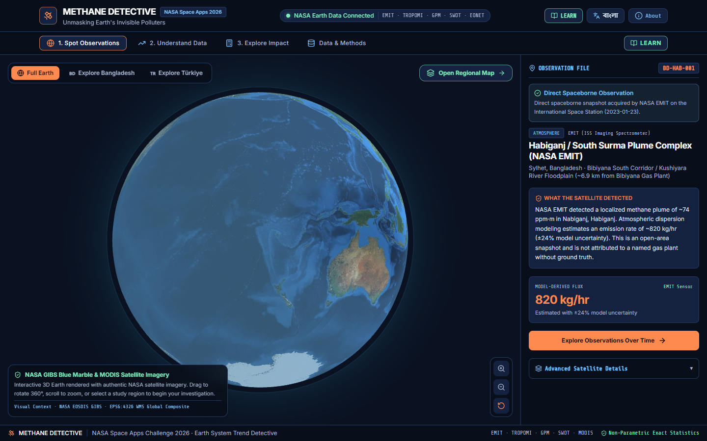
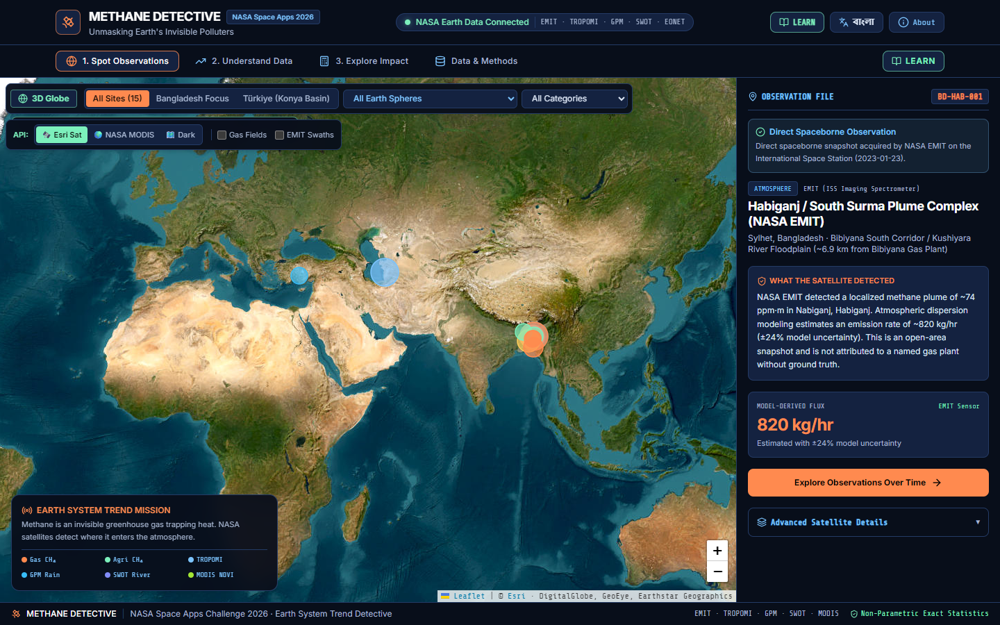
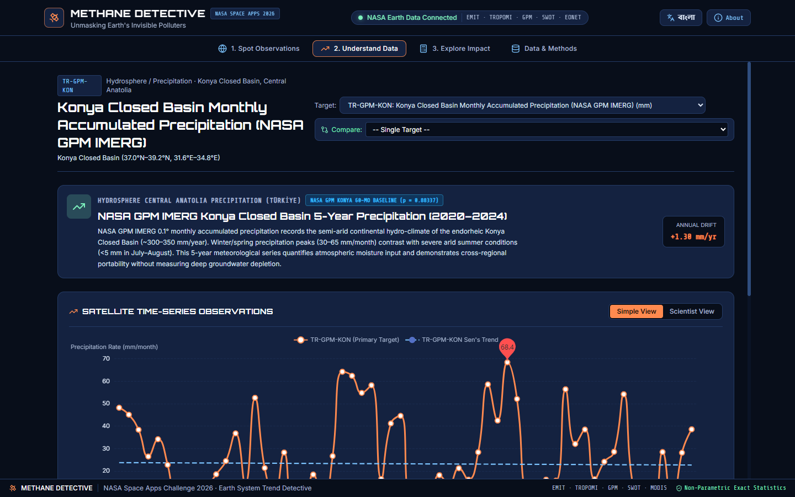
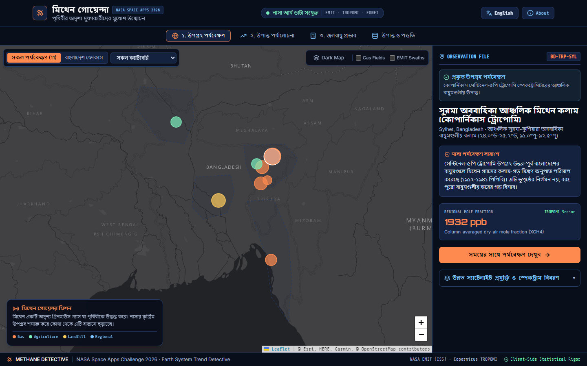

# METHANE DETECTIVE — Unmasking Earth's Invisible Polluters

**NASA Space Apps Challenge 2026**  
**Challenge Track:** *Be An Earth System Trend Detective!*  
**Team:** `RISING_CODERS_X`  
**Current Release:** V3.2 (Production & Scientifically Validated)  
**License:** [MIT License](file:///E:/Methane_Detective/LICENSE)  

---

```
  __  __ _____ _____ _   _    _    _   _ _____   ____  _____ _____ _____ ____ _____ _____     _____ 
 |  \/  | ____|_   _| | | |  / \  | \ | | ____| |  _ \| ____|_   _| ____/ ___|_   _|_ _\ \   / / ____|
 | |\/| |  _|   | | | |_| | / _ \ |  \| |  _|   | | | |  _|   | | |  _|| |     | |  | | \ \ / /|  _|  
 | |  | | |___  | | |  _  |/ ___ \| |\  | |___  | |_| | |___  | | | |__| |___  | |  | |  \ V / | |___ 
 |_|  |_|_____| |_| |_| |_/_/   \_\_| \_|_____| |____/|_____| |_| |_____\____| |_| |___|  \_/  |_____|
```

> **Unmasking Earth's invisible super-polluters by coupling spaceborne spectroscopy, hydrological radar, and vegetation phenology into an open-science causal trend engine.**

---

## 📑 Table of Contents
1. [Project Introduction](#1-project-introduction)
2. [Key Capabilities & Features](#2-key-capabilities--features)
3. [The Multi-Sphere Scientific Architecture](#3-the-multi-sphere-scientific-architecture)
4. [Technology Stack](#4-technology-stack)
5. [Visual Walkthrough & Evidence](#5-visual-walkthrough--evidence)
6. [System Requirements](#6-system-requirements)
7. [Web Application: Setup & Execution Guide](#7-web-application-setup--execution-guide)
8. [Testing & Scientific Verification](#8-testing--scientific-verification)
9. [Android Mobile App (APK): Installation & Build Guide](#9-android-mobile-app-apk-installation--build-guide)
10. [NASA & Partner Agency Data Attribution](#10-nasa--partner-agency-data-attribution)
11. [Scientific Methodology, Assumptions & Limitations](#11-scientific-methodology-assumptions--limitations)
12. [AI Tools & Transparency Statement](#12-ai-tools--transparency-statement)
13. [Team & Acknowledgements](#13-team--acknowledgements)

---

## 1. Project Introduction

### The Problem
Methane ($\text{CH}_4$) is responsible for nearly **one-third of net anthropogenic global warming** since pre-industrial times. Over a 20-year timescale, methane traps over **80 times more heat than carbon dioxide** ($\text{GWP}_{20} = 82.5$, IPCC AR6 Table 7.15 errata). Yet, methane is completely invisible to the human eye.

In dynamic delta basins such as Bangladesh, energy infrastructure (gas gathering fields, pipelines, compressor stations) sits directly adjacent to vast agricultural wetlands and seasonal rice paddies. Both emit methane. When a satellite overpass detects an atmospheric methane spike:
- *Is it an industrial fugitive leak requiring urgent valve repair?*
- *Or is it natural seasonal methanogenesis from flooded wetlands?*

A single satellite snapshot cannot answer this question. Without multi-year context and multi-sphere Earth system variables, isolated satellite observations produce false alarms that paralyze environmental decision-makers.

### The Solution: Methane Detective
**Methane Detective** answers NASA's *"Be An Earth System Trend Detective!"* challenge by coupling three distinct Earth spheres into a single causal investigation engine:
1. **Atmosphere:** Spaceborne point plumes from **NASA EMIT** on the ISS ($60\text{ m}$ VSWIR) and column dry-air mole fractions from **Sentinel-5P TROPOMI** ($7 \times 5.5\text{ km}$ SWIR).
2. **Hydrosphere:** Precipitation deluge from **NASA GPM IMERG** ($n=60$) and river flood waves from **NASA/CNES SWOT KaRIn** radar altimetry ($n=18$).
3. **Biosphere:** Haor wetland greenness and flood inundation decay from **NASA Terra MODIS NDVI** ($n=24$).

By evaluating these variables across contrasting climate regimes (the hyper-humid Bangladesh Delta vs. the semi-arid Konya Closed Basin in Türkiye) using **exact non-parametric small-sample statistics**, Methane Detective separates seasonal environmental cycles from industrial fugitive emissions.

---

## 2. Key Capabilities & Features

* 🌐 **Interactive 3D Full-Earth WebGL Globe:** Complete spherical planet view rendered with authentic NASA GIBS Blue Marble & MODIS textures. Features 60 FPS lockstep pin tracking, continuous $360^\circ$ rotation, smooth zoom momentum, and 1-click camera shortcuts to Bangladesh and Türkiye.
* 🗺️ **High-Resolution GIS Satellite Map:** Embedded Leaflet GIS viewer supporting live **Esri World Imagery**, **NASA GIBS Terra MODIS Corrected Reflectance**, and **CARTO Dark Matter** tile layers with interactive hotspot pulsing pins.
* 🔬 **Forensic Statistical Engine (Client-Side):**
  - **Theil-Sen Robust Estimator:** Median of pairwise slopes, resistant to outliers and cloud-masking noise.
  - **Exact Small-Sample Mann-Kendall Test ($n < 10$):** Evaluates exact all-permutations distribution via Kendall's generating function $G_n(x)$ with multiset tie correction, avoiding invalid asymptotic normal approximations.
  - **Hirsch (1982) Seasonal Mann-Kendall:** Removes 12-month cyclic patterns across 5-year precipitation climatologies ($n=60$).
  - **Open Science Honesty:** Strictly reports when a visual trend is not statistically significant (e.g. TROPOMI $p = 0.10868 \implies \text{Monotonic Null Not Rejected}$).
* 🇹🇷 **Dual-Basin Geographical Cross-Validation:** Contrasts the humid monsoon-dominated Bengal Basin against the semi-arid, endorheic Konya Closed Basin in Central Anatolia, Türkiye ($37.87^\circ\text{N}, 32.50^\circ\text{E}$, $26.4\text{ mm/mo}$ precipitation).
* 📥 **NASA Giovanni & AppEEARS CSV Ingest Engine:** 100% browser-based parser that strips headers, handles custom delimiters, filters missing values (`-9999`, `NaN`), and calculates live Mann-Kendall statistics for any custom NASA Earth data export in $<100\text{ ms}$.
* 🎛️ **IPCC AR6 Climate Mitigation Simulator:** Translates detected plume leak rates ($\text{kg/hr}$) into avoided 20-year and 100-year $\text{CO}_2$ equivalent emissions ($\text{CO}_2\text{e}_{20}$ and $\text{CO}_2\text{e}_{100}$), equivalent cars removed from roads, homes powered, and financial losses in BDT/USD.
* 🎓 **Interactive Learning Center (Bilingual EN / বাংলা):** Plain-language detective journey, visual glossary of remote sensing terms, interpretation guide, and instant bilingual toggle.
* 📱 **Native Android Mobile Application:** Capacitor-powered standalone Android APK with hardware-accelerated touch gestures, offline data caching, and native responsive layouts.

---

## 3. The Multi-Sphere Scientific Architecture

```
                                  ┌─────────────────────────────────────────┐
                                  │   SOUTHWEST ASIAN MONSOON PRECIPITATION │
                                  │        NASA GPM IMERG (n=60)            │
                                  └────────────────────┬────────────────────┘
                                                       │
                                  ┌────────────────────▼────────────────────┐
                                  │      MACRO-CHANNEL RIVER CREST          │
                                  │  NASA/CNES SWOT KaRIn (+5.27m on Jamuna)│
                                  └────────────────────┬────────────────────┘
                                                       │
                                  ┌────────────────────▼────────────────────┐
                                  │      HAOR WETLAND INUNDATION & DECAY    │
                                  │   NASA Terra MODIS NDVI (0.72 -> 0.17)  │
                                  └────────────────────┬────────────────────┘
                                                       │
                     ┌─────────────────────────────────┴─────────────────────────────────┐
                     ▼                                                                   ▼
       ┌───────────────────────────────┐                                   ┌───────────────────────────────┐
       │   NATURAL BIOGENIC EMISSIONS  │                                   │   FUGITIVE INDUSTRIAL LEAKS   │
       │ Microbial methanogenesis      │                                   │ Continuous high-flux point    │
       │ Highly seasonal (2-3 mo lag)  │                                   │ sources (e.g. Habiganj #583)  │
       │ Modest flux, broad area       │                                   │ 820 kg/hr, localized 60m plume│
       └───────────────────────────────┘                                   └───────────────────────────────┘
```

---

## 4. Technology Stack

* **Frontend Framework:** React 18.3, TypeScript 5.6
* **Build System & Dev Server:** Vite 6.0
* **Styling & Design System:** TailwindCSS 3.4, PostCSS, Lucide React icons
* **3D Spherical Rendering:** HTML5 Canvas, WebGL, Three.js spherical math
* **Geospatial & Mapping:** Leaflet 1.9, React-Leaflet, Esri World Imagery, NASA GIBS WMS/WMTS
* **Interactive Charting:** Apache ECharts 5.5, ECharts-for-React
* **Statistical Mathematics:** Custom TypeScript ESM engine (`statsEngine.ts`) implementing exact generating-function permutation algorithms and Sen's slope
* **Mobile Runtime:** Capacitor 8.6 Android native wrapper
* **Independent Scientific Harness:** Python 3 (urllib, math, json standard libraries)

---

## 5. Visual Walkthrough & Evidence

| 3D Full-Earth Satellite Globe | High-Resolution GIS Satellite Basemap |
| :---: | :---: |
|  |  |
| *Spherical 3D globe with 60 FPS lockstep pin tracking* | *Esri high-resolution satellite imagery with Habiganj plume* |

| Cross-Basin Climatology (Türkiye vs. Bangladesh) | Bilingual Learning Center (বাংলা) |
| :---: | :---: |
|  |  |
| *Konya Closed Basin 5-year Seasonal Mann-Kendall analysis* | *Bilingual education interface in Bengali and English* |

---

## 6. System Requirements

### For Running the Web Application
* **Node.js:** v18.0.0 or higher (v20+ recommended)
* **npm:** v9.0.0 or higher
* **Web Browser:** Any modern evergreen browser with WebGL support (Google Chrome 110+, Mozilla Firefox 115+, Microsoft Edge 110+, Safari 16+)

### For Running the Python Scientific Verification Suite
* **Python:** v3.9 or higher (standard library only — zero external pip packages required)

### For Building the Android APK from Source (Optional)
* **Java Development Kit (JDK):** JDK 17 (Temurin / OpenJDK)
* **Android SDK:** API Level 34 (Android 14) with Command-Line Tools & Build-Tools 34.0.0

---

## 7. Web Application: Setup & Execution Guide

### Option A: Windows Quick Start (1-Click)
Double-click `run_app.bat` in the project root. It will automatically verify dependencies, install npm packages if needed, and launch the development server at `http://localhost:5173`.

---

### Option B: Step-by-Step Manual Setup (Cross-Platform)

#### 1. Clone the repository
```bash
git clone https://github.com/Al-Yamin-313/methane-detective-2026.git
cd methane-detective-2026
```

#### 2. Install dependencies
```bash
npm install
```

#### 3. Start the local development server
```bash
npm run dev
```
Open your browser and navigate to:
```
http://localhost:5173
```

#### 4. Build for production
```bash
npm run build
```
The compiled, minified production assets will be output to the `dist/` directory.

#### 5. Preview the production build locally
```bash
npm run preview
```
Runs a local static web server serving the optimized `dist/` bundle on `http://localhost:4173`.

#### 6. Static Web Hosting Deployment (Optional)
The output `dist/` folder is a zero-backend, pure client-side Single Page Application (SPA). It can be deployed immediately to:
* **Vercel / Netlify:** Link repository or drag-and-drop the `dist/` folder.
* **GitHub Pages:** Deploy `dist/` via `gh-pages` branch or GitHub Actions.
* **Surge / Cloudflare Pages:** Point build output directory to `dist/`.

---

## 8. Testing & Scientific Verification

Methane Detective features two independent automated test suites to guarantee mathematical validity and open-science reproducibility.

### Suite 1: Automated Client-Side Statistical Tests (Node.js ESM)
Verifies exact Mann-Kendall generating function $G_n(x)$ distributions, tied multiset permutations, asymptotic approximations, and Seasonal Mann-Kendall calculations:
```bash
npm test
```
*Expected Result:*
```
[PASS] All standard and Seasonal Mann-Kendall assertions verified!
```

### Suite 2: NASA CMR Granule & Scientific Reproducibility Harness (Python 3)
Verifies live online NASA CMR LPCLOUD queries for EMIT granules, Sentinel-5P TROPOMI time series, IPCC AR6 errata factors, and 5-year multi-sphere datasets:
```bash
python scripts/reproduce_dataset.py
```
*Expected Result:*
```
=================================================================
SCIENTIFIC VERIFICATION COMPLETE: 100% PASSING
=================================================================
```

---

## 9. Android Mobile App (APK): Installation & Build Guide

Methane Detective is wrapped into a native Android application using Capacitor 8.6, enabling hardware-accelerated touch gestures, offline data caching, and native mobile responsiveness.

---

### Method A: Install the Pre-Compiled APK (Recommended for Judges & Evaluators)

A pre-compiled standalone Android APK is available directly in the [GitHub Releases](https://github.com/Al-Yamin-313/methane-detective-2026/releases/tag/v3.2.0) section of this repository.

#### Step-by-Step Installation:
1. On your Android smartphone or tablet (Android 8.0 Oreo or higher), open the [Releases](https://github.com/Al-Yamin-313/methane-detective-2026/releases/tag/v3.2.0) page.
2. Tap and download `Methane_Detective_v3.2.apk` (5.58 MB).
3. Open your device's **Downloads** folder (or notification shade) and tap `Methane_Detective_v3.2.apk`.
4. If Android displays *"For your security, your phone is not allowed to install unknown apps from this source"*:
   - Tap **Settings** on the prompt.
   - Toggle **"Allow from this source"** to ON.
   - Tap the back button.
5. Tap **Install** and then tap **Open**.

> [!NOTE]
> * **Internet Connection:** The app requires an active internet connection to stream satellite map tiles (Esri / NASA GIBS) and live NASA CMR API queries.
> * **Package Signing:** This is a debug-signed build intended for hackathon evaluation and testing. It is not currently published on the Google Play Store.

---

### Method B: Build the Android APK from Source (Developer Mode)

If you wish to compile the Android application locally from source:

#### 1. Prerequisites
* **Java Development Kit:** JDK 17 (Eclipse Temurin / OpenJDK 17)
* **Android SDK:** Platform API Level 34 with Android Build-Tools 34.0.0
* Environment variables `JAVA_HOME` and `ANDROID_HOME` configured.

#### 2. Configure Android SDK Path
Copy `android/local.properties.example` to `android/local.properties` and verify your SDK directory:
```properties
# Windows example:
sdk.dir=C\:\\Users\\<YourUsername>\\AppData\\Local\\Android\\Sdk
# macOS example:
# sdk.dir=/Users/<YourUsername>/Library/Android/sdk
# Linux example:
# sdk.dir=/home/<YourUsername>/Android/Sdk
```

#### 3. Build Web Bundle & Sync Capacitor
```bash
# Compile web application
npm run build

# Synchronize web assets into the Android native project
npx cap sync android
```

#### 4. Compile the APK via Gradle Wrapper
* **On Windows (PowerShell / Command Prompt):**
  ```cmd
  cd android
  .\gradlew.bat assembleDebug
  ```
* **On macOS / Linux:**
  ```bash
  cd android
  chmod +x gradlew
  ./gradlew assembleDebug
  ```

#### 5. Locate the Built APK
The compiled debug APK will be generated at:
```
android/app/build/outputs/apk/debug/app-debug.apk
```
You can install it directly to a connected Android device or emulator via:
```bash
adb install android/app/build/outputs/apk/debug/app-debug.apk
```

---

## 10. NASA & Partner Agency Data Attribution

In strict adherence to NASA Earth Science Open Data Policies and the 2026 Space Apps Challenge guidelines:

| Mission / Instrument | Agency | Product ID / Collection | Spatial & Temporal Resolution | Role in Platform |
| :--- | :---: | :--- | :--- | :--- |
| **NASA EMIT** | NASA / JPL | `EMIT_L2B_CH4PLM_002` | $60\text{ m}$ VSWIR / ISS orbit | High-resolution super-emitter point plume complexes ($\text{ppm}\cdot\text{m}$, $\text{kg/hr}$). Verified Granule: `000583`. |
| **Sentinel-5P TROPOMI** | ESA / Copernicus | `S5P_OFFL_L2__CH4____` | $7 \times 5.5\text{ km}$ SWIR / Daily | Regional atmospheric background column mole fraction ($X\text{CH}_4$ in $\text{ppb}$). Processor v02.09.01. |
| **NASA GPM IMERG** | NASA / GSFC | `GPM_3IMERGM_07` | $0.1^\circ \times 0.1^\circ$ Monthly | 5-Year Southwest Asian monsoon precipitation ($n=60$) & Konya Closed Basin climatology. |
| **NASA/CNES SWOT** | NASA / CNES | `SWOT_L2_HR_RiverSP_2.0` | KaRIn Interferometer | River water surface elevation on Jamuna River reach (Node #23481, $+5.27\text{ m}$ flood wave). |
| **NASA Terra MODIS** | NASA / LP DAAC | `MOD13Q1` | $250\text{ m}$ 16-Day Composite | Wetland green canopy vs. flood submergence (NDVI optical surface reflectance ratio, $n=24$). |
| **NASA EOSDIS GIBS** | NASA EOSDIS | `BlueMarble_NextGeneration` | Global EPSG:4326 | True-color planetary visual basemap on the 3D globe and GIS Leaflet map. |

### Mandatory Disclaimers
* **NASA Non-Endorsement:** NASA does not endorse this or any other participant project.
* **Copernicus Attribution:** Contains modified Copernicus Sentinel-5P data (2019–2024) processed by ESA / SRON / KNMI.
* **Basemaps:** Esri World Imagery tiles © Esri, Maxar, Earthstar Geographics. CARTO Dark Matter tiles © CARTO, OpenStreetMap contributors.

---

## 11. Scientific Methodology, Assumptions & Limitations

1. **Non-Parametric Trend Testing:**
   Environmental satellite data frequently violates normality assumptions and contains gaps due to cloud cover. Conventional ordinary least squares ($R^2$) regressions produce invalid inferences on small samples. We utilize the non-parametric **Theil-Sen estimator** for rate determination and the **Mann-Kendall test** for monotonic trend direction.
2. **Small-Sample Exact Permutation:**
   For sample sizes $n < 10$, the central limit theorem does not guarantee standard normal convergence. We evaluate exact all-permutations probability:
   $$G_n(x) = \prod_{k=1}^n \left( \sum_{j=0}^{k-1} x^j \right)$$
   With multiset tie correction when identical values occur.
3. **Honest Scientific Non-Rejection:**
   For regional Sentinel-5P TROPOMI data over Sylhet (`BD-TRP-SYL`), despite an apparent positive slope of $+12.81\ \text{ppb/year}$, the exact test yields $p = 0.10868$. Because $p \ge 0.05$, Methane Detective honestly reports **"MONOTONIC NULL NOT REJECTED"**. We refuse to manufacture artificial statistical certainty.
4. **Monsoon Cloud Gaps:**
   Optical and shortwave infrared spectrometers (EMIT, TROPOMI) cannot penetrate dense convective monsoon cloud decks, resulting in summer observational gaps. These gaps are preserved as authentic physical limits rather than filled with speculative interpolation.
5. **Study Period Limitations:**
   A 5-year observation record (e.g. Konya Basin precipitation) constitutes a meteorological baseline and must not be conflated with 30-year climatological normals or long-term climate change.
6. **Precipitation vs. Groundwater Drought:**
   Precipitation is a meteorological variable. Konya Closed Basin rainfall measurements do not directly measure groundwater depletion, which requires GRACE gravimetry or in-situ piezometric well telemetry.

---

## 12. AI Tools & Transparency Statement

In full compliance with NASA Space Apps Challenge 2026 rules regarding transparency and AI disclosure:
- **Google Antigravity CLI:** Used as an intelligent development agent and release engineering assistant to orchestrate project architecture, run automated builds, execute headless Chrome browser verifications, and audit codebase security.
- **Google Gemini:** Utilized for conceptual brainstorming of the multi-sphere causal framework, generating narrative presentation b-roll footage, and structuring Gemini Canvas pitch visual prompts.
- **Human Authorship & Rigor:** All scientific algorithms, mathematical generating function formulas, data extraction scripts, and application logic were verified, audited, and tested by team RISING_CODERS_X.

---

## 13. Team & Acknowledgements

### Team RISING_CODERS_X — Project Team Roles

| Team Member Names | Primary Project Role |
| :--- | :--- |
| **Yamin** (Abdullah Al-Yamin) | **Builder**, **Presenter** |
| **Mashrafi** (Mashrafi Elahi) | **Data Person**, **Presenter** |
| **Tahmid** (Md. Tahmid Alam) | **Designer** |
| **Zidan** (Abid Hasan Zidan) | **Presenter** |
| **Nadim** (Lutful Ahmed Nadim) | **Presenter** |
| **Jami** (Farhan Israq Jami) | **Video Person** |

#### Official Space Apps Submission Role Allocation
* **Builder:** Yamin
* **Data Person:** Mashrafi
* **Designer:** Tahmid
* **Presenter:** Yamin, Zidan, Mashrafi, Nadim
* **Video Person:** Jami

Developed for the **NASA Space Apps Challenge 2026**.  
*For questions, inquiries, or research collaboration, please open an issue in this repository.*
