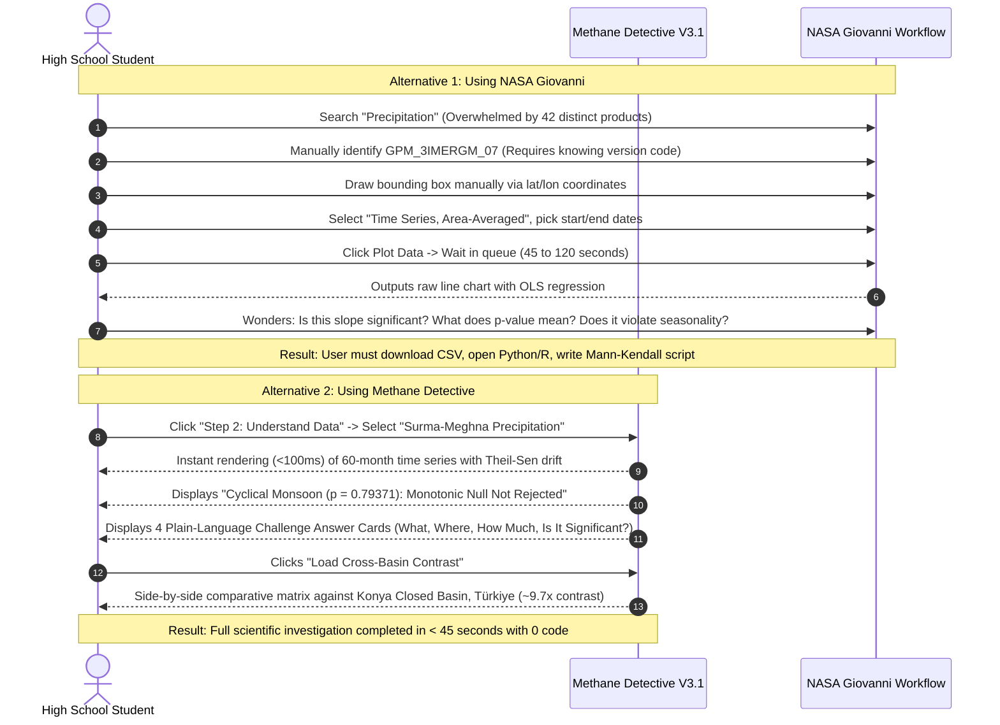

# COMPETITIVE DIFFERENTIATION & MARKET WORKFLOW ANALYSIS

**Project:** METHANE DETECTIVE — Unmasking Earth's Invisible Polluters  
**Challenge:** NASA Space Apps Challenge 2026 — *Be An Earth System Trend Detective!*  
**Team:** `RISING_CODERS_X`  
**Workspace:** `E:\Methane_Detective`  
**Evaluation Date:** November 2026  
**Auditor:** Independent SaaS Product & Technology Strategy Analyst  

---

## 1. The Core Product Question

> *"Why should a student, researcher, or citizen scientist open METHANE DETECTIVE instead of simply using NASA Giovanni, NASA Worldview, or KNMI Climate Explorer?"*

A credible answer cannot rely on inflated marketing claims. We must conduct a forensic examination of the **actual working capabilities, user interfaces, friction points, and output formats** of NASA's existing flagship Earth observation tools, comparing them directly against Methane Detective.

---

## 2. In-Depth Profile of Existing Competing Platforms

### 2.1 NASA Giovanni (GES DISC)
- **URL / Ecosystem:** `https://giovanni.gsfc.nasa.gov/giovanni/`
- **Core Mission:** Web-based data visualization, exploration, and basic analysis for NASA Goddard Earth Sciences (GES) Data and Information Services Center (DISC).
- **Strengths:**
  - Massive repository of atmospheric chemistry, precipitation, temperature, and aerosol datasets ($>2,000$ variables).
  - Powerful server-side spatial and temporal averaging across global gridded NetCDF/HDF5 data.
  - Generates time series, Hovmöller diagrams, scatter plots, and spatial anomaly maps.
- **Critical Friction Points & Weaknesses:**
  - **Overwhelming Technical Barrier:** Users are greeted with an enterprise faceted search interface containing complex metadata filters (Platform, Instrument, Processing Level, Grid Resolution, Discipline). Selecting a simple rainfall variable requires navigating through dozens of confusing product codes (`GPM_3IMERGM_07`, `MERRA2_400`, `AIRS3STM_7_0`).
  - **Long Queue Latencies:** Server-side aggregation queries routinely take 30 to 180 seconds to queue and execute; queries often time out or fail when large spatial boxes are selected.
  - **No Non-Parametric Trend Testing:** Giovanni generates raw time-series line charts and can output an Ordinary Least Squares (OLS) linear regression line, but **it does NOT execute non-parametric Mann-Kendall tests, does NOT calculate Sen's slopes, does NOT provide exact small-sample permutation tests, and does NOT evaluate statistical p-values**.
  - **Absence of Plain-Language Interpretation:** Giovanni outputs raw numeric axes without contextual interpretation. It never explains whether a trend is statistically significant, whether the data violates i.i.d. assumptions, or what the environmental result means for the local population.

### 2.2 NASA AppEEARS (LP DAAC)
- **URL / Ecosystem:** `https://appeears.earthdatacloud.nasa.gov/`
- **Core Mission:** Application for Extracting and Exploring Analysis Ready Samples (AppEEARS) by NASA Land Processes Distributed Active Archive Center (LP DAAC).
- **Strengths:**
  - Highly efficient subsetting of MODIS, VIIRS, ECOSTRESS, and Landsat surface reflectance/NDVI/LST data.
  - Excellent spatial polygon clipping and pixel quality-flag decoding.
- **Critical Friction Points & Weaknesses:**
  - **Asynchronous Batch Queue:** AppEEARS is strictly an extraction utility, not an exploratory interactive playground. Submitting a sample request requires authenticating via NASA Earthdata Login, defining spatial vectors, and waiting minutes or hours for an email notification before data can be visualized.
  - **No Cross-Mission Statistical Synthesis:** AppEEARS focuses exclusively on land products. It cannot correlate MODIS vegetation phenology with spaceborne methane plumes (EMIT) or atmospheric column mole fractions (TROPOMI).

### 2.3 NASA Worldview & GIBS
- **URL / Ecosystem:** `https://worldview.earthdata.nasa.gov/`
- **Core Mission:** Full-resolution interactive browsing of global satellite imagery via Global Imagery Browse Services (GIBS).
- **Strengths:**
  - Exceptional daily and sub-daily global visual exploration ($>1,000$ imagery layers).
  - Smooth temporal timeline scrubbing for tracking acute environmental events (wildfires, dust storms, typhoons).
- **Critical Friction Points & Weaknesses:**
  - **Qualitative Visual Browsing Only:** Worldview is an image browser, not a statistical analytics tool. Users cannot click a pixel to generate a multi-year time-series chart, calculate an annual drift rate, or evaluate trend significance.
  - **No Methane Spectroscopy Layers:** Spaceborne methane plume retrieval maps from ISS EMIT or Copernicus TROPOMI Level-2 are not directly native or queryable as time-series data inside Worldview.

### 2.4 NASA Earthdata Search
- **URL / Ecosystem:** `https://search.earthdata.nasa.gov/`
- **Core Mission:** The comprehensive discovery and order broker for all NASA EOSDIS data ($>10,000$ collections).
- **Strengths:** Granule-level precision, spatial granule bounding, access to raw HDF5/NetCDF files.
- **Critical Friction Points & Weaknesses:** Extremely intimidating for non-programmers. Downloading raw granules requires command-line scripting (Python/cURL), Earthdata tokens, and domain expertise in reading multi-dimensional arrays.

### 2.5 KNMI Climate Explorer
- **URL / Ecosystem:** `https://climexp.knmi.nl/`
- **Core Mission:** Professional scientific workbench for climate data analysis maintained by the Royal Netherlands Meteorological Institute (KNMI).
- **Strengths:** Exhaustive statistical capabilities (correlations, spectra, EOFs, extremes).
- **Critical Friction Points & Weaknesses:** Outdated 1990s-era academic interface; steep learning curve; inaccessible to students, journalists, or policy analysts without a graduate degree in atmospheric physics or climate statistics.

---

## 3. Real-World User Workflow Comparison

To evaluate whether Methane Detective simplifies user tasks, let us trace two standard user journeys:

### User Journey A: Investigating Multi-Year Rainfall Trends in a Specific Basin
*Goal: Determine if precipitation is changing significantly over a 5-year period in a regional watershed.*



### User Journey B: Connecting Methane Plumes with Environmental Drivers
*Goal: Investigate whether observed methane spikes correlate with regional flood inundation.*

| Step | Existing Multi-Tool Workflow | Methane Detective V3.1 Workflow |
| :--- | :--- | :--- |
| **1. Plume Discovery** | Search NASA Earthdata for EMIT granule `000583`; download 1.2 GB NetCDF; run Python code to render plume polygon. | Select `BD-HAB-001` on map; instant rendering of verified 21-vertex plume polygon and 820 kg/hr emission rate. |
| **2. Regional Column Context** | Open Copernicus Open Access Hub or SentiWiki; download TROPOMI $X\text{CH}_4$ orbits; apply cloud filter scripts. | Switch to `BD-TRP-SYL`; view bias-corrected 2.5-year TROPOMI column series ($1912\text{--}1941\text{ ppb}$, $p = 0.10868$). |
| **3. Environmental Coupling** | Open NASA Giovanni for GPM rainfall; open AppEEARS for MODIS NDVI; export two separate CSVs; align dates in Excel. | Select Earth Sphere tabs (`Atmosphere`, `Hydrosphere`, `Biosphere`); view coupled response (monsoon deluge $\to$ haor submergence $\to$ methanogenesis conditions). |
| **4. Cloud Gaps Explanation** | Read optical physics manuals to understand why TROPOMI data is missing in June–August. | UI explicitly explains: *"Deep convective monsoon clouds (cloud fraction > 0.85) attenuate SWIR signals, triggering quality mask ($qa < 0.50$)."* |

---

## 4. Comprehensive 14-Dimension Competitive Comparison Matrix

| Feature / Capability | NASA Giovanni | NASA AppEEARS | NASA Worldview | KNMI Climate Exp. | Methane Detective V3.1 |
| :--- | :---: | :---: | :---: | :---: | :---: |
| **1. Variable Breadth** | **Huge (>2,000)** | Moderate (~100) | **Huge (>1,000)** | **Huge (>10,000)** | Focused (5 native + arbitrary CSV) |
| **2. Spatial Coverage** | **Global** | **Global** | **Global** | **Global** | Multi-Regional (BD, TR, US, TM) |
| **3. Interface Usability** | Complex | Moderate | Intuitive | Highly Complex | **Beginner-First (3 Steps)** |
| **4. Latency to First Chart** | 30–180s | Minutes (batch) | Immediate (map) | 10–30s | **Instant (< 100ms)** |
| **5. Non-Parametric Trend Math** | None (OLS only) | None | None | Advanced (MK) | **Advanced (Exact MK + Theil-Sen)** |
| **6. Exact Small-Sample Permutation** | None | None | None | None | **Fully Implemented ($n \le 10$)** |
| **7. Tie-Adjusted Multiset Permutation** | None | None | None | None | **Fully Implemented ($n \le 8$)** |
| **8. Hirsch Seasonal Mann-Kendall** | None | None | None | Scripted only | **Fully Implemented (12-Season)** |
| **9. Cross-Basin Contrast Matrix** | Manual | None | Split screen | Complex script | **Dedicated 1-Click Synthesis** |
| **10. Multi-Sphere Cross-Coupling** | Fragmented | None | Visual overlay | Numerical only | **Guided Storytelling Framework** |
| **11. Client-Side Data Ingestion** | None | None | None | Server upload | **1-Click Parser (Giovanni CSV)** |
| **12. Plain-Language Translation** | None | None | Basic metadata | None | **4-Question Plain-English Cards** |
| **13. Climate Impact Equivalents** | None | None | None | None | **IPCC AR6 Errata Abatement Model** |
| **14. Bilingual Localization** | English only | English only | English only | English only | **English & Bengali (বাংলা)** |

---

## 5. Identifying the Actual Unique Value Proposition (UVP)

When evaluating Methane Detective against multi-million-dollar government tools, the team must be honest about where the platform wins and where it cannot compete:

### Where Existing NASA Platforms Win
1. **Catalog Scale:** NASA Giovanni and Earthdata Search contain petabytes of global gridded datasets. Methane Detective does not possess a cloud computing backend to compute 50-year global gridded anomalies on demand.
2. **Raw Spatial Processing:** Giovanni can compute spatial bounding averages across custom user-drawn polygons anywhere on Earth in real time. Methane Detective relies on pre-curated regional investigations or user-uploaded CSV files extracted from Giovanni.

### Where Methane Detective Genuinely Outperforms
1. **The "Last Mile" of Scientific Understanding:** NASA's tools are designed by and for remote sensing scientists. They assume the user already understands sensor physics, quality flags, and statistical test limitations. Methane Detective bridges the chasm between raw satellite numbers and human understanding through its **4-Question Challenge Framework** and **Simple vs. Scientist progressive disclosure**.
2. **Rigorous Non-Parametric Statistics as a First-Class Citizen:** Existing web portals rely on naïve Ordinary Least Squares (OLS) linear regressions that are easily distorted by atmospheric outliers or seasonal cycles. Methane Detective executes **exact combinatorial permutations**, **multiset tie enumeration**, and **Hirsch Seasonal Mann-Kendall** directly in the browser with zero external server dependencies.
3. **Cross-Sphere Earth System Synthesis:** Rather than treating methane as an isolated atmospheric gas, Methane Detective illustrates how the hydrosphere (monsoon rainfall, river flood waves) and biosphere (wetland inundation) provide the physical context for biogenic methanogenesis and optical sensor data gaps.
4. **Instant Extensibility via Reusable Ingestion:** The built-in NASA Giovanni & AppEEARS CSV engine allows any researcher or student to bring outside data into the platform, instantly benefiting from its automated statistical testing and visualization suite.

---

## 6. Strategic Positioning: Complementary Tool or Replacement?

> **Verdict:** Methane Detective is **NOT a replacement** for NASA Earth Science Data Systems (ESDS). Attempting to pitch it as a replacement would be scientifically unconvincing and tactically fatal in front of NASA judges.

Instead, Methane Detective's strongest, most defensible product positioning is as an **Integrated Educational & Scientific Analysis Layer** that sits directly on top of NASA's open data infrastructure:

```
+-----------------------------------------------------------------------------------+
|                        METHANE DETECTIVE (PRODUCT POSITION)                       |
+-----------------------------------------------------------------------------------+
|  [ LAYER 3: HUMAN & EDUCATIONAL SYNTHESIS ]                                       |
|  • 3-Step Guided Workflow • Plain-Language Cards • Bilingual Localization         |
|  • Climate Impact Abatement Simulator • Cross-Basin Contrast Matrix               |
+-----------------------------------------------------------------------------------+
|  [ LAYER 2: ADVANCED STATISTICAL & TREND DETECTIVE ENGINE ]                       |
|  • Exact Permutation Mann-Kendall • Tie-Adjusted Multiset • Theil-Sen Drift       |
|  • Hirsch Seasonal Mann-Kendall (1982) • Client-Side Giovanni CSV Ingestion       |
+-----------------------------------------------------------------------------------+
|  [ LAYER 1: NASA OPEN DATA INFRASTRUCTURE (UNDERLYING FOUNDATION) ]               |
|  • NASA GES DISC (Giovanni) • NASA LP DAAC (AppEEARS/EMIT) • NASA PO.DAAC (SWOT)  |
|  • Copernicus Sentinel-5P (ESA) • NASA Earthdata CMR / GIBS Imagery               |
+-----------------------------------------------------------------------------------+
```

By positioning itself as an **interpretive analysis workbench and pedagogical companion** that makes NASA's authoritative data understandable, actionable, and statistically robust, Methane Detective creates authentic, differentiated value without making unsustainable claims.
