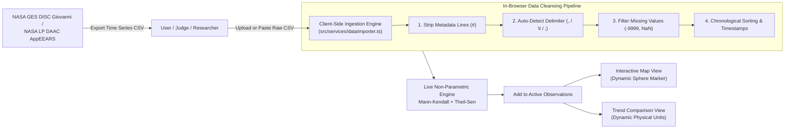

# USER & SCIENTIST GUIDE: NASA GIOVANNI & APPEEARS DATA INGESTION ENGINE

**Project:** METHANE DETECTIVE — Unmasking Earth's Invisible Polluters  
**Team:** RISING_CODERS_X  
**Challenge:** NASA Space Apps Challenge 2026 — Be An Earth System Trend Detective!  
**Workspace:** `E:\Methane_Detective`  
**Classification:** Client-Side Data Ingestion Architecture & NASA Open API Guide  

---

## 1. PURPOSE & ARCHITECTURE OVERVIEW

A central requirement of the NASA Space Apps Challenge 2026 is providing an extensible framework that empowers researchers and citizen scientists to explore any Earth-system trend, not merely pre-packaged datasets.

Methane Detective features a built-in, 100% client-side **NASA Giovanni & AppEEARS Data Ingest Engine**. This engine allows users to:
1. Export time-series CSV data directly from official NASA portals (GES DISC Giovanni, LP DAAC AppEEARS, or PO.DAAC).
2. Upload or paste the raw CSV file into Methane Detective.
3. Automatically strip metadata comments (`#`), detect delimiters, filter missing/fill values (`-9999`, `NaN`), and sort observations chronologically.
4. Calculate non-parametric Mann-Kendall statistics ($S$, $Z$, $p$) and Theil-Sen annual slopes live in the browser.
5. Add the imported series directly to active map and trend visualizations with 1 click.



---

## 2. SUPPORTED CSV SCHEMAS & SPECIFICATIONS

The importer accommodates diverse NASA DAAC export formats without requiring pre-formatting:

### 2.1 NASA GES DISC Giovanni Time-Series CSV Format
```csv
# NASA Goddard Earth Sciences Data and Information Services Center (GES DISC)
# Giovanni Time Series, Area-Averaged
# Variable: GPM_3IMERGM_07_precipitation (Monthly Precipitation Rate)
# Units: mm/month
# Latitude: 24.5000 to 25.0000, Longitude: 91.5000 to 92.0000
# User Notes: NASA open science data export
time,precipitation
2023-01-01,14.8
2023-02-01,22.4
2023-03-01,78.2
2023-04-01,165.7
2023-05-01,410.3
2023-06-01,682.1
2023-07-01,614.5
2023-08-01,489.2
2023-09-01,312.8
2023-10-01,142.1
2023-11-01,28.6
2023-12-01,9.4
```

### 2.2 NASA LP DAAC AppEEARS CSV Format
```csv
# Application for Extracting and Exploring Analysis Ready Samples (AppEEARS)
# Sensor: Terra MODIS (MOD13Q1.061)
# Coordinate: 25.12, 91.08
Date,_250m_16_days_NDVI
2023-01-01,0.582
2023-01-17,0.594
2023-02-02,0.612
...
```

### 2.3 General Two-Column CSV Format
Any standard CSV file containing `date` (or `time`, `datetime`, `timestamp`, `year_month`) in column 0 and a numerical observation value in column 1.

---

## 3. DATA CLEANSING & VALIDATION PIPELINE

When raw CSV text is parsed via `parseGiovanniCsv(rawText)`:

1. **Comment Header Extraction:**
   - Lines beginning with `#` are analyzed with regex matchers to automatically extract the variable name (`Variable:\s*(.*)`), physical unit (`Units?:\s*([^\r\n,]+)`), and coordinate bounds (`(Latitude|Lat|Bounding Box):?\s*([^\r\n]+)`).
2. **Delimiter Autodetection:**
   - Evaluates comma `,`, tab `\t`, and semicolon `;` occurrences on the first data row to determine the active delimiter.
3. **Missing Value Screening:**
   - Identifies and excludes null values, empty cells, and fill indicators (`-9999`, `-999.0`, `NaN`, `null`, `inf`).
   - Counts and displays total dropped soundings in the UI so data loss is fully transparent.
4. **Chronological Sorting:**
   - Parses dates into ISO timestamps (`Date.parse()`).
   - Automatically sorts rows chronologically from oldest to newest to ensure monotonic time differences ($\Delta t > 0$).
5. **Validation Threshold:**
   - Requires at least 3 valid soundings. Datasets with fewer than 3 observations fail validation with an informative error message.

---

## 4. STEP-BY-STEP TUTORIAL: INGESTING GIOVANNI DATA

### Step 1: Download Data from NASA Giovanni
1. Visit the NASA GES DISC Giovanni portal: `https://giovanni.gsfc.nasa.gov/giovanni/`
2. Select your variable of interest (e.g., GPM IMERG Precipitation, AIRS Carbon Monoxide, or MERRA-2 Temperature).
3. Under **Select Plot**, choose **Time Series, Area-Averaged**.
4. Define your bounding box or country boundary and select a date range (e.g., 2020 to 2024).
5. Click **Plot Data**.
6. Under the plot, click **Downloads** $\to$ **CSV (comma-separated values)**.

### Step 2: Ingest into Methane Detective
1. In Methane Detective, navigate to the **Data & Methods** tab in the top navigation bar.
2. Under the section tabs, click **NASA Giovanni Importer**.
3. You can either:
   - Click the orange **"Load GPM Giovanni Sample"** button to instantly test a verified 12-month GPM precipitation time series.
   - Click **"Choose File"** to upload your downloaded `.csv` file.
   - Paste the raw text directly into the text box and click **"Parse & Validate CSV"**.

### Step 3: Inspect Live Statistical Results
Upon successful parsing, the interface displays:
- **Green Validation Badge:** `VALID NASA TIME SERIES DETECTED`.
- **Metadata Card:** Variable Name, Scientific Unit, Earth Sphere (Atmosphere, Hydrosphere, or Biosphere), and count of Dropped Soundings.
- **Live Mann-Kendall Evaluation:** Theil-Sen Annual Slope, Test Statistic $S$, and p-value.

### Step 4: Add to Active Observations
1. Click the blue button: **"Add to Active Observations"**.
2. The application automatically registers the imported time series as an active Earth-system observation (`CUSTOM-GIO-xxx`), transitions you to the **2. Understand Data (Trends)** view, and graphs your custom dataset against regional baselines!

---

## 5. REAL-TIME NASA REST APIs

In addition to user CSV imports, Methane Detective actively integrates with two public, open NASA REST endpoints that require zero API keys or authentication:

### 5.1 NASA EONET v3 (Earth Observatory Natural Event Tracker)
- **Endpoint:** `https://eonet.gsfc.nasa.gov/api/v3/events?category=wildfires,severeStorms`
- **Purpose:** Fetches active natural hazards, storm paths, and thermal fire anomalies that drive regional atmospheric emissions and flood events.
- **Response Format:** Open GeoJSON feature collection.

### 5.2 NASA CMR Search API (Common Metadata Repository)
- **Endpoint:** `https://cmr.earthdata.nasa.gov/search/granules.json`
- **Purpose:** Verifies real-time granule metadata, processing levels, and spatial footprints across NASA Earthdata archives.
- **Client Implementation:** Executed asynchronously with fallbacks to ensure instantaneous UI response even under low-bandwidth conditions.
