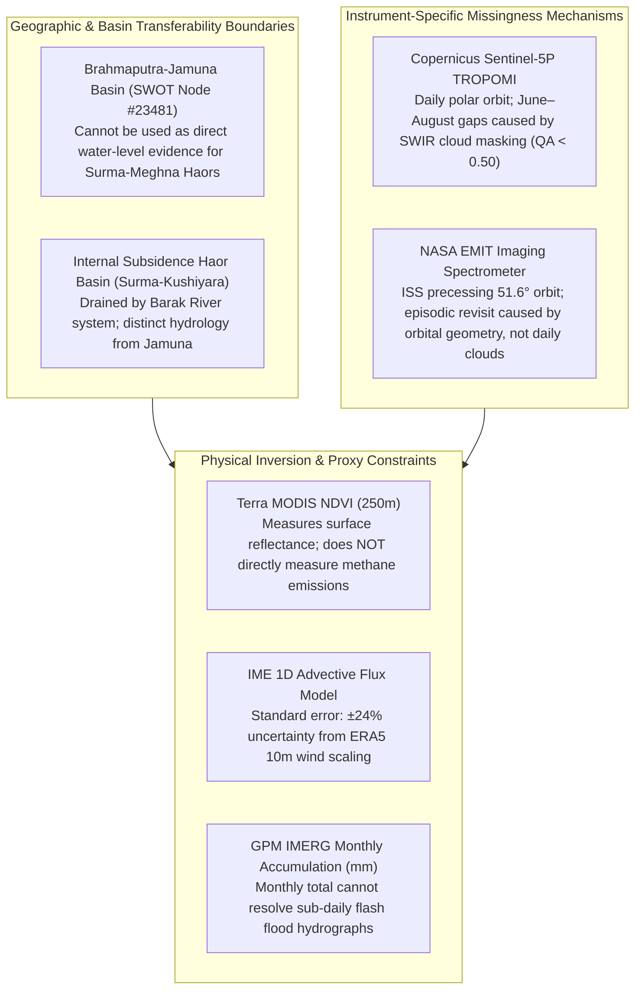

# SCIENTIFIC LIMITATIONS, UNCERTAINTIES & BOUNDARY CONDITIONS

**Project:** METHANE DETECTIVE — Unmasking Earth's Invisible Polluters  
**Team:** `RISING_CODERS_X`  
**Challenge:** NASA Space Apps Challenge 2026 — Be An Earth System Trend Detective! (Advanced)  
**Workspace:** `E:\Methane_Detective`  
**Classification:** Scientific Limitations and Uncertainty Boundaries Manual (Post-Forensic Audit)  

---

## 1. PRINCIPLE OF SCIENTIFIC TRANSPARENCY

Scientific integrity demands transparent disclosure of observational boundaries, instrumental limitations, and mathematical uncertainties. No satellite sensor observes Earth with 100% temporal continuity or zero error. 

This document details the physical, orbital, and mathematical constraints governing each sensor, basin model, and statistical routine implemented in Methane Detective.

---

## 2. GEOGRAPHIC & BASIN TRANSFERABILITY LIMITATIONS

### 2.1 Basin Invariance Fallacy
- **The Physical Reality:** Bangladesh is not a single uniform hydrological catchment. The **Brahmaputra-Jamuna River System** and the **Surma-Meghna River System** are distinct macro-basins separated by the Madhupur Pleistocene tract.
- **The Constraint:** The SWOT observation series (`BD-SWOT-JAM`) is located at Reach Node #23481 ($24.550^\circ\text{N}, 89.850^\circ\text{E}$) on the braided Jamuna River. This data captures the macro-scale flood wave of the Brahmaputra system.
- **Explicit Boundary:** **SWOT Jamuna measurements CANNOT be cited as direct evidence for water levels or flood depths inside the Surma-Meghna Haor basin** (e.g., Tanguar Haor or Hakaluki Haor, ~180 km to the east). They are presented strictly as a comparative macro-hydrology baseline illustrating Bangladesh's broader monsoon runoff regime.

---

## 3. INSTRUMENT-SPECIFIC MISSINGNESS MECHANISMS

A rigorous audit requires distinguishing why observations are missing across different instruments:

### 3.1 Copernicus Sentinel-5P TROPOMI (Low Earth Orbit)
1. **Daily Overpass Opportunity:** TROPOMI orbits in a polar, sun-synchronous orbit with an ascending equator crossing at ~13:30 local solar time, providing daily theoretical coverage over Bangladesh.
2. **Optical Cloud Shielding:** During the Southwest Monsoon (June to August), deep convective storm clouds consistently produce cloud fractions $>0.85$. Shortwave infrared (SWIR) solar radiation cannot penetrate these opaque cloud decks.
3. **Retrieval Rejection:** The RemoTeC proxy retrieval algorithm and operational quality filter ($\text{qa\_value} > 0.50$, supplemented by $\text{cloud\_fraction} < 0.20$) systematically reject these cloudy soundings.
4. **Scientific Conclusion:** For TROPOMI, seasonal data gaps in summer are **directly caused by cloud attenuation and retrieval quality filtering**.

### 3.2 NASA EMIT Spectrometer (International Space Station)
1. **Non-Sun-Synchronous Precessing Orbit:** EMIT is mounted on the ISS (inclination $51.6^\circ$, altitude ~400 km). Unlike polar orbiters, the ISS orbital ground track precesses continuously, resulting in non-repeating local solar crossing times and irregular revisit cycles ranging from days to weeks.
2. **Targeted Swath Acquisition:** EMIT has a narrow 75 km swath and does not record continuous global imagery. Data collection is duty-cycled and scheduled over priority targets during daylight with solar zenith angles $<60^\circ$.
3. **Scientific Conclusion:** Missing dates in EMIT are **primarily governed by orbital mechanics, ground track geometry, and targeted instrument scheduling**, rather than continuous cloud rejection. Attributing all EMIT gaps to monsoon clouds is methodologically incorrect.

---

## 4. PHYSICAL INVERSION & PROXY BOUNDARIES

### 4.1 Terra MODIS NDVI Proxy Limitations
1. **Optical Surface Reflectance Only:** The Normalized Difference Vegetation Index (NDVI) is calculated from optical red and near-infrared reflectance. It measures canopy greenness, photosynthetic activity, and open-water surface submergence (water strongly absorbs near-infrared sunlight).
2. **No Direct Gas Detection:** **NDVI does NOT directly measure atmospheric methane concentrations, biological methanogenesis rates, or gas flux.**
3. **Defensible Application:** In Methane Detective, MODIS NDVI serves strictly to document the seasonal timing of Haor wetland inundation ($0.72 \to 0.17$), establishing when standing-water conditions recognized in biogeochemical literature as conducive to anaerobic methanogenesis occur.

### 4.2 Integrated Methane Enhancement (IME) Wind Speed Scaling
1. **1D Advective Wind Parameterization:** The mass flux inversion model:
   $$Q = \frac{U_{\text{eff}} \cdot \text{IME}}{L}$$
   relies on parameterizing effective advection speed $U_{\text{eff}}$ from surface reanalysis winds (ERA5 10m winds).
2. **Uncertainty Propagation Budget ($\pm 24\%$):**
   - Wind speed error ($\sigma_{U_{\text{eff}}}/U_{\text{eff}}$): $\pm 20\%$ due to local aerodynamic drag and boundary layer turbulence.
   - Column retrieval error ($\sigma_{\text{IME}}/\text{IME}$): $\pm 12\%$ due to surface albedo heterogeneity and spectroscopic noise.
   - Plume length scale error ($\sigma_L/L$): $\pm 6\%$ due to segmentation boundary thresholding.
   - **Combined Root-Sum-Square Uncertainty:**
     $$\frac{\sigma_Q}{Q} = \sqrt{(0.20)^2 + (0.12)^2 + (0.06)^2} \approx \mathbf{\pm 24.08\%}$$
3. **Snapshot vs. Annual Emissions:** A single overpass measures gas enhancement over a matter of milliseconds. Point-source emissions can vary due to facility operational adjustments, gas venting, or maintenance cycles. Annual tonnage extrapolations are illustrative scale comparisons assuming steady-state flow and cannot prove continuous 24/7 emission without multi-pass monitoring.

### 4.3 GPM IMERG Monthly Accumulation vs. Flash Floods
1. **Temporal Aggregation Scale:** `GPM_3IMERGM_07` provides **Monthly Accumulated Precipitation ($\text{mm}$)** over a $0.1^\circ \times 0.1^\circ$ grid (~10 km).
2. **Sub-Daily Hydrograph Invisibility:** While ideal for multi-year trend analysis ($n=60$), monthly accumulation values cannot resolve sub-daily convective cloudbursts or flash flood hydrographs in the piedmont basins beneath the Meghalaya plateau.

---

## 5. ATTRIBUTION & LEGAL DISCLOSURES

1. **No Corporate or Individual Blame:** All observations in Methane Detective are localized by geographical coordinates, administrative districts, and general facility classifications (e.g., "Natural Gas Wellhead & Dehydration Area", "Municipal Waste Facility"). Methane Detective does not assign legal blame, name commercial entities, or assert regulatory non-compliance.
2. **Mandatory Non-Endorsement Notice:** NASA does not endorse any non-U.S. Government entity and is not responsible for information contained on non-U.S. Government websites.
3. **Educational & Research Purpose:** The platform is engineered for open scientific discovery, student education, and public awareness under the NASA Space Apps Challenge 2026.
