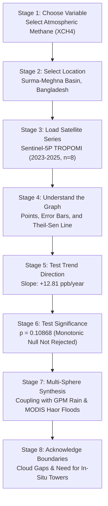

# LEARNING EXPERIENCE, PEDAGOGICAL DESIGN & COMPREHENSIVE SCIENTIFIC GLOSSARY AUDIT

**Project:** METHANE DETECTIVE — Unmasking Earth's Invisible Polluters  
**Challenge:** NASA Space Apps Challenge 2026 — *Be An Earth System Trend Detective!*  
**Team:** `RISING_CODERS_X`  
**Workspace:** `E:\Methane_Detective`  
**Evaluation Date:** November 2026  
**Auditor:** Educational Experience, Instructional Design & Science Communication Specialist  

---

## 1. Executive Pedagogical Audit

> *"Teaching is not the act of dumping raw technical documentation into an interface. True scientific education occurs when a curious non-expert can interact with an unfamiliar system, understand its vocabulary at the moment of encounter, test an authentic hypothesis, and comprehend the real-world significance of the result without feeling overwhelmed or inadequate."*

This audit evaluates whether Methane Detective V3.1 provides an adequate learning experience, assesses the total absence of a top-level Learning Center, evaluates the necessity of an interactive guided tutorial, conducts an exhaustive 33-term scientific glossary audit, and establishes how the application should teach users to benefit from Earth-system results.

---

## 2. Part A: Does V3.1 Have a Proper Learning Center?

### 2.1 Direct Forensic Finding
**NO. Methane Detective V3.1 does NOT have a dedicated "LEARN", "LEARNING CENTER", "GUIDE", or "HOW IT WORKS" tab in its navigation.**

- **Current Application Structure:**
  The main navigation bar (`src/components/Navigation.tsx`) consists of exactly four tabs:
  1. `Step 1: Spot Observations` (`explore` $\to$ MapView)
  2. `Step 2: Understand Data` (`trends` $\to$ TrendView)
  3. `Step 3: Explore Impact` (`impact` $\to$ ClimateSimulatorView)
  4. `Data & Methods` (`methods` $\to$ DataMethodsView)
- **Where Educational Content Currently Lives:**
  Educational text is fragmented and scattered across three disconnected locations:
  1. An introductory card titled *"Methane 101: Why Methane Matters"* at the top of the Data & Methods view.
  2. An expandable accordion (`<details>`) buried at the bottom of the Trend View under the label *"🔬 Advanced Scientific Mathematics & Statistical Calculations (For Researchers)"*.
  3. Extensive, high-quality markdown files stored inside the `docs/` directory (`SCIENTIFIC_METHODOLOGY.md`, `KNOWN_LIMITATIONS.md`, `DATA_SOURCES_AND_ATTRIBUTION.md`), which are completely inaccessible to an ordinary web user browsing the application.

### 2.2 Would a Dedicated Learning Center Materially Improve the Product?
**YES, profoundly.** For a hackathon entry competing in the *Advanced* category, judges and educators specifically look for pedagogical scaffolding. Adding a dedicated **Learning Center** tab in the navigation would transform the application from an impressive data viewer into an empowering educational platform for high school classrooms, university environmental science labs, and citizen scientists.

---

## 3. Part B: The Need for an Interactive Guided Tutorial ("Learn by Doing")

### 3.1 The Failure of Lengthy Documentation
Reading a 20-page scientific methodology manual before using an application is an archaic model that modern users reject. Beginners learn by **active doing**, immediate feedback, and contextual scaffolding.

### 3.2 Specification for the Ideal 8-Stage Interactive Walkthrough
A guided walkthrough should be accessible via a prominent button (e.g., `Start Guided Case Study: The Sylhet Haor Investigation`) that walks the user through an authentic end-to-end investigation:



---

## 4. Part C: Exhaustive Scientific Glossary Audit (33 Terms)

To establish whether the application explains technical terms in context, each of the **33 foundational Earth-system, remote-sensing, and statistical terms** is audited below against five rigorous criteria:
1. *What does it mean?*
2. *Why does it matter?*
3. *Where is it used in the application?*
4. *How should a user interpret it?*
5. *What is a common misunderstanding?*

---

### Group 1: Core Trend Analysis Terms (18 Terms)

#### 1. Earth-System Variable
- **Meaning:** A measurable physical, chemical, or biological quantity characterizing a component of the Earth system (atmosphere, hydrosphere, biosphere, cryosphere, lithosphere).
- **Why it matters:** Isolates specific environmental processes from the chaos of raw nature.
- **Where used:** Top bar sphere selectors, dataset registry, and Q1 Answer Card.
- **How to interpret:** Represents the specific physical phenomenon being tracked over time.
- **Common misunderstanding:** Believing all variables measure the same thing or can be directly compared without unit conversion.

#### 2. Time Series
- **Meaning:** A sequence of quantitative observations recorded at successive, chronological points in time.
- **Why it matters:** Enables researchers to distinguish temporary weather spikes from persistent multi-year trajectories.
- **Where used:** Interactive ECharts canvas in Trend View (`Step 2`).
- **How to interpret:** The horizontal axis represents chronological time; the vertical axis represents magnitude in native units.
- **Common misunderstanding:** Assuming data points must be recorded at perfectly identical time intervals; satellite passes often have irregular revisit times.

#### 3. Observation
- **Meaning:** A single, discrete spaceborne measurement soundings acquired during a specific orbital pass over a defined geographic footprint.
- **Why it matters:** Satellite data is not continuous like a physical garden hose; it consists of individual snapshots.
- **Where used:** Data points on the time-series chart and observation tables.
- **How to interpret:** Each dot represents an authentic sensor measurement subject to quality filtering.
- **Common misunderstanding:** Confusing a satellite observation with continuous, real-time streaming data.

#### 4. Trend
- **Meaning:** The long-term general movement or direction in a time series, abstracting away short-term noise and seasonal oscillations.
- **Why it matters:** Establishes whether an environmental system is undergoing systematic change.
- **Where used:** Trend View title banner and rate summary badges.
- **How to interpret:** A trend indicates net multi-year trajectory, not what will happen tomorrow.
- **Common misunderstanding:** Assuming a high value today means the overall trend is upward.

#### 5. Trend Direction
- **Meaning:** The qualitative sign of the trajectory: Rising (increasing), Falling (decreasing), or Stable/Cyclical (no monotonic shift).
- **Why it matters:** Provides an immediate, plain-language classification of system behavior.
- **Where used:** Main Verdict Banner in Trend View.
- **How to interpret:** Rising means systematic accumulation; Falling means systematic reduction; Stable means cyclical fluctuations around a steady baseline.
- **Common misunderstanding:** Assuming a rising trend is always "bad"; for vegetation (NDVI), a rising trend often indicates ecological recovery or crop growth.

#### 6. Rate of Change
- **Meaning:** The quantitative amount of change in a variable per unit of time (e.g., $+12.81\text{ ppb/year}$).
- **Why it matters:** Establishes the speed and urgency of an environmental process.
- **Where used:** Q3 NASA Challenge Answer Card and Quick Rate Badge.
- **How to interpret:** Indicates how much the variable shifts in an average calendar year.
- **Common misunderstanding:** Assuming the system changes by exactly that amount every single year; it represents the central median slope.

#### 7. Slope
- **Meaning:** The mathematical gradient of the line fitted to the time series ($\Delta y / \Delta t$).
- **Why it matters:** Quantifies the steepness of the trajectory.
- **Where used:** Theil-Sen drift line and statistical summary tables.
- **How to interpret:** Positive slope = upward drift; Negative slope = downward drift; Zero slope = flat baseline.
- **Common misunderstanding:** Believing that any non-zero slope is automatically important; tiny slopes can occur purely from random sampling noise.

#### 8. Theil-Sen Estimator (Sen's Slope)
- **Meaning:** A robust, non-parametric statistical method that computes the median of all pairwise slopes between all possible combinations of data points.
- **Why it matters:** Unlike standard Ordinary Least Squares (OLS) regression, Sen's slope is highly resistant to extreme outliers and does not assume normally distributed errors.
- **Where used:** Primary trendline calculation in `statsEngine.ts` and Trend View.
- **How to interpret:** Represents the most truthful median annual trajectory of the observations.
- **Common misunderstanding:** Believing Sen's slope requires an equal number of points per year; it calculates exact $\Delta t$ between timestamps.

#### 9. Mann-Kendall Test
- **Meaning:** A non-parametric, distribution-free statistical hypothesis test used to assess whether a monotonic upward or downward trend exists over time.
- **Why it matters:** It does not assume data is normally distributed and is immune to missing values and non-linear monotonic curves.
- **Where used:** `statsEngine.ts` and Q4 NASA Challenge Answer Card.
- **How to interpret:** Evaluates the relative ranking of points: if later points consistently exceed earlier points, $S$ becomes strongly positive.
- **Common misunderstanding:** Assuming the Mann-Kendall test measures linear correlation; it strictly evaluates monotonic order.

#### 10. Exact Permutation Test
- **Meaning:** A combinatorial technique that calculates the exact theoretical probability of observing a test statistic $S$ by evaluating all $n!$ possible permutations of the dataset.
- **Why it matters:** For small sample sizes ($n < 10$), standard normal approximations ($Z$-scores) fail, producing inaccurate p-values.
- **Where used:** Small-sample TROPOMI evaluation ($n=8$) in `statsEngine.ts`.
- **How to interpret:** Provides the exact mathematical probability without relying on large-sample approximations.
- **Common misunderstanding:** Assuming exact permutation can be calculated instantly for large $n$; $n!$ grows factorially, requiring asymptotic formulas for $n \ge 10$.

#### 11. Statistical Significance
- **Meaning:** A formal determination that an observed pattern or trend is highly unlikely to have occurred purely by random chance.
- **Why it matters:** Prevents decision-makers from reacting to random noise or seasonal weather fluctuations.
- **Where used:** Q4 Answer Card and verdict badges.
- **How to interpret:** If $p < 0.05$, the trend is statistically significant (confidence $> 95\%$). If $p \ge 0.05$, the trend is not established.
- **Common misunderstanding:** Believing statistical significance implies real-world practical importance; a tiny, harmless drift can be statistically significant if sample size is huge.

#### 12. P-Value
- **Meaning:** The probability of obtaining test results at least as extreme as the observed data, assuming that the null hypothesis (no trend) is completely true.
- **Why it matters:** Serves as the quantitative gatekeeper for scientific claims.
- **Where used:** Statistic badges across Trend View and Data & Methods.
- **How to interpret:** Low p-value ($< 0.05$) = strong evidence against the null hypothesis; High p-value ($\ge 0.05$) = data is consistent with random chance or cyclical noise.
- **Common misunderstanding:** Believing $p = 0.05$ means there is a 5% chance the trend is real; it measures the probability of the data given the null hypothesis, NOT the probability of the hypothesis.

#### 13. Null Hypothesis ($H_0$)
- **Meaning:** The default baseline assumption that there is no relationship, no trend, and no systematic change in the underlying system.
- **Why it matters:** Enforces scientific skepticism: a claim of environmental change must prove itself against the null.
- **Where used:** Trend View verdict headers (`MONOTONIC NULL NOT REJECTED`).
- **How to interpret:** If the evidence is insufficient, we fail to reject the null hypothesis.
- **Common misunderstanding:** Believing "failing to reject the null" means the null is proven true; it simply means evidence is insufficient to reject it.

#### 14. Confidence Interval (95% CI)
- **Meaning:** A mathematically bounded range of values within which the true parameter (e.g., annual slope) is expected to lie with 95% probability.
- **Why it matters:** Quantifies the margin of error and uncertainty around an estimate.
- **Where used:** The shaded confidence envelope in Scientist View on the ECharts canvas.
- **How to interpret:** A narrow envelope indicates high precision; a wide envelope indicates sparse data or high volatility.
- **Common misunderstanding:** Assuming individual observations must fall inside the 95% slope confidence interval; it bounds the *trend slope*, not raw data scatter.

#### 15. Seasonal Variation (Seasonality)
- **Meaning:** Recurring, predictable fluctuations in a time series that repeat at regular calendar intervals (e.g., monsoonal summer rains vs. winter dry spells).
- **Why it matters:** Seasonal amplitude is often $10\times$ larger than the annual climate change signal, obscuring multi-year trends.
- **Where used:** GPM Precipitation and MODIS NDVI trend analyses.
- **How to interpret:** Peaks and troughs repeating every 12 months reflect the astronomical orbit and annual weather cycle.
- **Common misunderstanding:** Mistaking a severe summer monsoon flood for a permanent, irreversible climate shift.

#### 16. Anomaly
- **Meaning:** The departure or difference of an observed value from its long-term climatological baseline mean for that specific calendar month.
- **Why it matters:** Strips away the predictable 12-month seasonal cycle, exposing true underlying environmental disruptions.
- **Where used:** Cross-basin climatology and anomaly decomposition in `statsEngine.ts`.
- **How to interpret:** Positive anomaly = wetter/hotter than usual for that month; Negative anomaly = drier/cooler than normal.
- **Common misunderstanding:** Assuming an anomaly is an error or outlier; an anomaly is simply a departure from average.

#### 17. Temporal Autocorrelation (Serial Correlation)
- **Meaning:** The statistical correlation of a variable with its own past values across successive time steps (e.g., July rainfall correlating with June rainfall).
- **Why it matters:** Violates the independent observation assumption of classical statistics, artificially inflating test statistics and causing false alarms (Type I errors).
- **Where used:** Seasonal Mann-Kendall rationale in `SCIENTIFIC_METHODOLOGY.md` and UI caveats.
- **How to interpret:** High autocorrelation requires stratified seasonal testing (Hirsch SMK) to compare July only with past Julys.
- **Common misunderstanding:** Ignoring autocorrelation when evaluating monthly environmental time series.

#### 18. Missing Observation
- **Meaning:** An expected time step in a series for which no valid measurement was recorded by the sensor.
- **Why it matters:** Real satellite records contain gaps due to cloud cover, orbital geometry, or instrument calibration.
- **Where used:** TROPOMI monsoon gaps and Giovanni CSV importer cleaner.
- **How to interpret:** Gaps must be acknowledged transparently rather than synthetically fabricated or smoothed over.
- **Common misunderstanding:** Believing missing observations invalidate an investigation; non-parametric tests easily handle missing time steps.

---

### Group 2: Satellite & Remote Sensing Terms (15 Terms)

#### 19. Remote Sensing
- **Meaning:** The science of acquiring information about Earth's surface and atmosphere from a distance, typically via satellite sensors measuring reflected or emitted electromagnetic radiation.
- **Why it matters:** Provides synoptic, planetary-scale environmental monitoring impossible with ground stations alone.
- **Where used:** Application subtitle and Data & Methods catalog.
- **How to interpret:** Satellites do not touch the air; they detect light, radar echoes, and infrared absorption.
- **Common misunderstanding:** Believing remote sensing satellites take standard smartphone photographs; they record multi-spectral wavelengths.

#### 20. Spatial Resolution
- **Meaning:** The physical dimensions of the ground area represented by a single pixel in a satellite image (e.g., $60\text{ m}$ for EMIT vs. $0.1^\circ \approx 10\text{ km}$ for GPM).
- **Why it matters:** Dictates whether a sensor can pinpoint a localized gas leak or only monitor an entire province.
- **Where used:** Observation metadata cards in Map View and Data Attribution Register.
- **How to interpret:** Finer resolution ($60\text{ m}$) = local point details; Coarse resolution ($10\text{ km}$) = regional macro patterns.
- **Common misunderstanding:** Expecting a coarse regional sensor (TROPOMI) to spot an individual pipe valve.

#### 21. Temporal Resolution (Revisit Time)
- **Meaning:** The frequency with which a satellite sensor observes the exact same geographic location on Earth.
- **Why it matters:** Dictates how rapidly changes and acute events can be tracked.
- **Where used:** Dataset specifications in `DataMethodsView.tsx`.
- **How to interpret:** Daily revisit = high temporal monitoring; 21-day revisit = episodic periodic monitoring.
- **Common misunderstanding:** Assuming a satellite is constantly hovering overhead; polar orbiters pass once per day or less.

#### 22. Granule
- **Meaning:** The smallest independently cataloged and downloadable data package produced by a NASA Earth-observing satellite mission.
- **Why it matters:** Serves as the precise digital evidence record in NASA archives.
- **Where used:** NASA CMR telemetry indicator and provenance registers.
- **How to interpret:** A granule represents a specific geographic strip acquired during a single orbital overpass.
- **Common misunderstanding:** Confusing a single granule with an entire multi-year mission archive.

#### 23. Collection (Data Collection)
- **Meaning:** A standardized, version-controlled group of granules sharing identical processing algorithms and calibration parameters.
- **Why it matters:** Ensures data consistency across multi-year studies.
- **Where used:** NASA CMR Concept ID queries (`C3242707413-LPCLOUD`).
- **How to interpret:** A collection aggregates thousands of granules into a unified product.
- **Common misunderstanding:** Assuming different collections of the same sensor can be mixed without calibration adjustments.

#### 24. Product Version
- **Meaning:** The specific numerical release iteration of the software processing algorithm used to convert raw satellite telemetry into scientific variables (e.g., GPM v07, TROPOMI v2.9.1).
- **Why it matters:** Upgrades in calibration algorithms alter baseline values; studies must declare the exact version used.
- **Where used:** Data Attribution Register and scientific methodology docs.
- **How to interpret:** Always verify that time series do not mix disparate product versions.
- **Common misunderstanding:** Assuming version updates are minor bug fixes; remote sensing version updates often revise radiative transfer physics completely.

#### 25. Quality Flag (QA Value)
- **Meaning:** A numerical reliability metric assigned to each satellite sounding, encoding atmospheric interference, cloud cover, and solar zenith angle.
- **Why it matters:** Discarding poor-quality soundings prevents erroneous spike artifacts.
- **Where used:** TROPOMI filter ($\text{qa\_value} > 0.50$) and GPM IMERG Final Run flags.
- **How to interpret:** High QA ($> 0.50$) = high-confidence clear-sky retrieval; Low QA ($< 0.50$) = cloudy, degraded, or invalid.
- **Common misunderstanding:** Believing all pixels in a satellite image are equally trustworthy.

#### 26. Geographic Coverage (Footprint / Bounding Box)
- **Meaning:** The spatial boundary coordinates (latitude/longitude extent) within which measurements are acquired or aggregated.
- **Why it matters:** Prevents spatial misattribution between distinct watersheds or provinces.
- **Where used:** Leaflet bounding polygons and Giovanni spatial queries.
- **How to interpret:** Identifies the precise rectangular boundary or polygon where data applies.
- **Common misunderstanding:** Assuming a measurement taken over one basin represents the entire nation.

#### 27. Atmospheric Column Concentration
- **Meaning:** The total mass or number of gas molecules present within a vertical column of air extending from Earth's surface to the top of the atmosphere.
- **Why it matters:** Satellites look down through the entire atmosphere; they do not measure only surface air.
- **Where used:** TROPOMI $X\text{CH}_4$ and EMIT plume enhancement descriptions.
- **How to interpret:** Reflects the integrated abundance across all altitudes.
- **Common misunderstanding:** Describing column methane as "surface air quality"; high column values can occur from stratospheric transport.

#### 28. XCH4
- **Meaning:** The column-averaged dry-air mole fraction of methane, expressed in parts per billion (ppb).
- **Why it matters:** Normalizing methane molecules against dry air ($\text{O}_2 + \text{N}_2$) eliminates fluctuations caused by barometric surface pressure changes.
- **Where used:** `BD-TRP-SYL` dataset and Sentinel-5P inspector.
- **How to interpret:** Values around $1900\text{--}1950\text{ ppb}$ represent contemporary Northern Hemisphere background levels.
- **Common misunderstanding:** Assuming an increase of $10\text{ ppb}$ in $X\text{CH}_4$ is an explosive hazard; it represents planetary-scale background greenhouse accumulation.

#### 29. NDVI (Normalized Difference Vegetation Index)
- **Meaning:** An optical surface reflectance ratio computed from red and near-infrared light: $(\rho_{\text{NIR}} - \rho_{\text{Red}}) / (\rho_{\text{NIR}} + \rho_{\text{Red}})$.
- **Why it matters:** Healthy green chlorophyll reflects near-infrared while absorbing red light; water absorbs both, causing NDVI to drop near zero.
- **Where used:** `BD-MOD-NDVI` dataset for Tanguar/Hakaluki Haor.
- **How to interpret:** High NDVI ($0.6\text{--}0.8$) = dense green crop canopy; Low NDVI ($0.1\text{--}0.2$) = standing open water or flood submergence.
- **Common misunderstanding:** Assuming NDVI measures methane emissions directly; it is an optical proxy for wetland inundation timing.

#### 30. GPM IMERG
- **Meaning:** Integrated Multi-satellitE Retrievals for GPM (Global Precipitation Measurement), NASA's flagship multi-satellite precipitation algorithm combining microwave and radar sensors with ground rain gauges.
- **Why it matters:** Provides unified, gridded precipitation totals across land and ocean worldwide.
- **Where used:** `BD-GPM-SYL` and `TR-GPM-KON` precipitation records.
- **How to interpret:** Final Run (v07) provides research-grade, gauge-adjusted accumulated rainfall depth (mm).
- **Common misunderstanding:** Believing IMERG comes from a single satellite; it merges a constellation of international spacecraft.

#### 31. NASA EMIT
- **Meaning:** Earth Surface Mineral Dust Source Investigation, an advanced imaging spectrometer mounted on the International Space Station (ISS) operating in the VSWIR spectrum ($380\text{--}2500\text{ nm}$).
- **Why it matters:** Possesses the high spectral and spatial resolution ($60\text{ m}$) required to identify localized methane super-emitter plumes.
- **Where used:** `BD-HAB-001` Habiganj gas plume observation.
- **How to interpret:** Yields path-integrated enhancement maps ($\text{ppm}\cdot\text{m}$) capable of being inverted into mass flow rates (kg/hr).
- **Common misunderstanding:** Assuming EMIT has daily global coverage; it operates on the ISS's inclined precessing orbit with an episodic revisit.

#### 32. Copernicus Sentinel-5P TROPOMI
- **Meaning:** TROPOspheric Monitoring Instrument aboard the European Space Agency's Copernicus Sentinel-5 Precursor satellite, measuring atmospheric trace gases with a daily global revisit.
- **Why it matters:** The gold standard for regional background methane monitoring and large-scale atmospheric column mapping.
- **Where used:** `BD-TRP-SYL` regional background time series.
- **How to interpret:** Tracks broad regional mole fractions ($X\text{CH}_4$ in ppb) across a $5.5 \times 7\text{ km}$ footprint.
- **Common misunderstanding:** Expecting TROPOMI to detect small fugitive pipe leaks; its footprint averages gas over roughly 38 square kilometers.

#### 33. NASA/CNES/CSA SWOT
- **Meaning:** Surface Water and Ocean Topography mission, featuring the Ka-band Radar Interferometer (KaRIn), a joint mission between NASA, CNES (France), CSA (Canada), and UKSA.
- **Why it matters:** First satellite mission capable of measuring water surface elevation (WSE) on inland rivers wider than $50\text{--}100\text{ m}$ with centimeter-level vertical precision.
- **Where used:** `BD-SWOT-JAM` Jamuna River stage time series.
- **How to interpret:** Measures river height in meters above the EGM2008 geoid, tracking the passage of seasonal flood waves ($+5.27\text{ m}$ amplitude).
- **Common misunderstanding:** Assuming SWOT measures river discharge directly; discharge is calculated using height, slope, and width models.

---

## 5. Part D: Contextual Help & Micro-Learning Architecture

To avoid turning the interface into dense, unreadable text walls, educational content should be deployed using a **tri-level progressive disclosure architecture**:

```
[ LEVEL 1: Micro-Tooltips & Info Icons (Hover / Tap) ]
  • Definition on demand (1-2 sentences)
  • Example: Hovering over 'p-value' reveals: "p = 0.108: Probability that this trend occurred by random chance. p > 0.05 means monotonic null is not rejected."

[ LEVEL 2: Inline Contextual Banners & Answer Cards ]
  • Explains what is changing, where, and whether it is significant in plain language directly below the chart.

[ LEVEL 3: Dedicated Learning Center Tab ]
  • Full conceptual articles, interactive visual animations, guided case studies, and complete glossary reference.
```

---

## 6. Part E: Teaching Users How to Benefit from Results (Beyond the Number)

An exceptional educational platform must never end after calculating a mathematical slope. It must teach users **what to do next with the finding** without exaggerating into unsupported causal claims:

### Case 1: When Precipitation is Decreasing / In Deficit (e.g., Konya Closed Basin)
- **What the user learns:** The time series quantifies meteorological moisture supply entering the basin. A dry period indicates reduced atmospheric deposition.
- **What to investigate next:** Look at agricultural groundwater pumping data, soil moisture models (NASA SMAP), and reservoir storage (NASA GRACE gravity anomalies).
- **Crucial scientific boundary:** Do NOT claim satellite rainfall directly measures sinkhole collapses or well depletion; agricultural overdraft is the primary driver.

### Case 2: When NDVI Drops Seasonally (e.g., Sylhet Haor Wetlands)
- **What the user learns:** Near-infrared absorption by standing floodwaters causes an optical drop from $0.62$ down to $0.17$, tracking the physical timing of wetland submergence.
- **What to investigate next:** Examine seasonal temperature and water residency time to understand when conditions become optimal for anaerobic bacterial methanogenesis.
- **Crucial scientific boundary:** Do NOT claim the NDVI drop is gas flux; it is an optical surface reflectance proxy.

### Case 3: When River Stage Surges (e.g., Jamuna River SWOT Altimetry)
- **What the user learns:** Radar altimetry measures a $+5.27\text{ m}$ seasonal flood wave crest between April and July, capturing macro-hydrology driven by Himalayan snowmelt.
- **What to investigate next:** Compare upstream precipitation in Assam/Tibet with downstream Brahmaputra stage gauges to track flood wave propagation times.
- **Crucial scientific boundary:** Do NOT use Jamuna river stage as direct evidence of internal Surma-Meghna Haor water levels; they are distinct river systems separated by the Madhupur Tract.

### Case 4: When Methane Shows an Upward Drift or Plume Spike
- **What the user learns:** Distinguish between a persistent background rise (TROPOMI $+12.81\text{ ppb/year}$, which tracks global Northern Hemisphere growth) and an acute point plume ($642\text{ ppm}\cdot\text{m}$, which indicates an active point source emission).
- **What to investigate next:** Overlay gas transmission infrastructure maps, wind vectors, and landfill boundaries to identify potential contributing facilities.
- **Crucial scientific boundary:** Do NOT name a specific company or facility without ground-truth physical verification.
