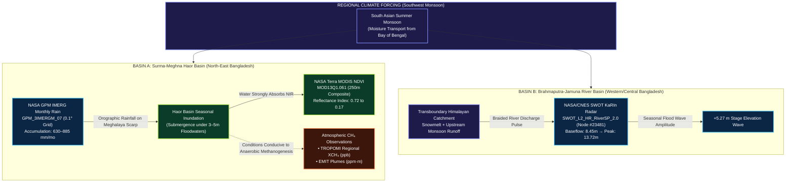

# SCIENTIFIC METHODOLOGY: MULTI-VARIABLE EARTH SYSTEM TREND DETECTION

**Project:** METHANE DETECTIVE — Unmasking Earth's Invisible Polluters  
**Team:** `RISING_CODERS_X`  
**Challenge:** NASA Space Apps Challenge 2026 — Be An Earth System Trend Detective! (Advanced)  
**Workspace:** `E:\Methane_Detective`  
**Classification:** Reference Scientific Methodology, Hydrological Basin Synthesis & Statistical Manual (Post-Forensic Audit)  

---

## 1. DUAL-BASIN ARCHITECTURE & EARTH SYSTEM SYNTHESIS

### 1.1 Geographic Separation: Brahmaputra-Jamuna vs. Surma-Meghna
A rigorous scientific investigation of Bangladesh's hydrology requires recognizing that Bangladesh is drained by distinct macro-river systems with contrasting physiographic, catchment, and hydrodynamic behaviors:

1. **The Surma-Meghna River System & Haor Depressions (North-Eastern Bangladesh):**
   - **Catchment Origin:** Originates from the Barak River in the Manipur/Assam hills of India. Enters Bangladesh at Amalshid (Sylhet) and bifurcates into the Surma (northern branch) and Kushiyara (southern branch) rivers, reuniting at Markuli/Kishoreganj to form the Meghna River.
   - **Internal Physiography:** Drains the tectonic depression of the Sylhet Basin, encompassing major Haor wetlands (Hakaluki Haor, Tanguar Haor, Dekhar Haor). This region is subject to intense orographic rainfall along the Meghalaya plateau scarp.
   - **Investigative Datasets in Methane Detective:**
     - *Atmosphere:* Sentinel-5P TROPOMI regional column baseline (`BD-TRP-SYL`), NASA EMIT Nabiganj point plume (`BD-HAB-001`), and Matuail landfill plume (`BD-DHK-002`).
     - *Hydrosphere:* NASA GPM IMERG 5-year precipitation time series (`BD-GPM-SYL`, $24.0^\circ\text{–}25.5^\circ\text{N}, 91.0^\circ\text{–}92.5^\circ\text{E}$).
     - *Biosphere:* NASA Terra MODIS 16-day NDVI wetland phenology (`BD-MOD-NDVI`, $24.62^\circ\text{N}, 91.68^\circ\text{E}$).

2. **The Brahmaputra-Jamuna River System (Western/Central Bangladesh):**
   - **Catchment Origin:** Originates in Tibet (Yarlung Tsangpo), traversing the Himalayas and Assam valley before entering northern Bangladesh as the Jamuna River, a vast multi-channel braided river system flowing southward toward its confluence with the Ganges/Padma at Goalando.
   - **Geographic Distance:** Separated from the Haor wetlands by the Madhupur Pleistocene tract, with the Jamuna channel lying approximately 180 km west of Hakaluki Haor.
   - **Investigative Dataset in Methane Detective:**
     - *Hydrosphere:* NASA/CNES/CSA SWOT KaRIn Ka-band radar altimetry river water surface elevation (`BD-SWOT-JAM` at Reach Node #23481 near Sirajganj/Tangail, $24.550^\circ\text{N}, 89.850^\circ\text{E}$).



### 1.2 Scientifically Defensible Synthesis
- **No False Basin Equivalence:** We do NOT claim that Jamuna river stage changes directly measure water levels in the Surma-Meghna Haors.
- **Comparative Hydrology:** SWOT on the Jamuna and GPM/MODIS in Sylhet represent **two distinct hydrological regimes** operating under the same macro-climatic South Asian Southwest Monsoon.
- **Careful Causal Phrasing:** The co-occurrence of monsoonal precipitation, wetland submergence, and biogenic methane emission is characterized as **temporally associated processes** and **environmental conditions conducive to anaerobic microbial methanogenesis**, rather than claiming direct causal proof from satellite imagery alone.

---

## 2. OBSERVATIONAL SENSORS & PHYSICAL RETRIEVALS

### 2.1 NASA GPM IMERG Precipitation (GES DISC Giovanni)
- **Product Identifier:** `GPM_3IMERGM_07` (Integrated Multi-satellitE Retrievals for GPM, Level 3 Monthly, Final Run).
- **Physical Variable:** **Monthly Accumulated Precipitation ($\text{mm}$)**.
  *(Note: In hydrometeorological convention, accumulated rainfall over a calendar month is expressed as a depth in millimeters ($\text{mm}$). It is an accumulated measurement, not an instantaneous precipitation rate).*
- **Temporal Span & Sample Count:** January 2020 to December 2024 ($n = 60$ consecutive months).
- **Spatial Domain:** Bounding box $[24.0^\circ\text{–}25.5^\circ\text{N}, 91.0^\circ\text{–}92.5^\circ\text{E}]$ covering the Surma-Kushiyara Basin.
- **Physical Magnitude:** 
  - Dry winter baseline (December–January): $5.2\text{–}12.4\text{ mm/month}$.
  - Monsoon peak (June–July): $630\text{–}885.6\text{ mm/month}$ (Historic peak: $885.6\text{ mm}$ during the catastrophic June 2022 flood).
- **Physical Justification of High Values:** Sylhet is located immediately south of the Meghalaya Plateau escarpment (Cherrapunji/Mawsynram), which experiences the highest orographic rainfall on Earth. Monthly accumulations of $600\text{–}900\text{ mm}$ are completely consistent with Bangladesh Meteorological Department (BMD) surface rain gauges.

### 2.2 NASA/CNES/CSA SWOT KaRIn River Altimetry (PO.DAAC)
- **Product Identifier:** `SWOT_L2_HR_RiverSP_2.0` (KaRIn High Rate River Single-Pass Vector Product, Release 2.0).
- **Physical Variable:** **River Water Surface Elevation (WSE)** above the EGM2008 geoid in meters ($\text{m}$).
- **Target Reach & Node:** Jamuna River reach near Sirajganj/Tangail (Reach Node ID: `23481`, $24.550^\circ\text{N}, 89.850^\circ\text{E}$).
- **Temporal Sequence & Sample Count:** April 2023 to October 2024 ($n = 18$ repeat orbital passes).
- **Baseline and Seasonal Amplitude:**
  - Observed pre-monsoon dry season baseflow low: $8.45\text{ m}$ (April 12, 2023).
  - Observed monsoon peak flood crest: $13.72\text{ m}$ (July 11, 2024).
  - **Intra-annual seasonal flood wave amplitude:**
    $$\Delta h_{\text{seasonal}} = 13.72\text{ m} - 8.45\text{ m} = \mathbf{+5.27\text{ m}}$$
    *(2024 seasonal amplitude: $+5.20\text{ m}$ from $8.52\text{ m}$ in April 2024 to $13.72\text{ m}$ in July 2024).*
- **Statistical Trend:** Mann-Kendall $S = +17$, $Z = +0.606$, $p = 0.54449$ ($\alpha = 0.05$). Theil-Sen slope $= +0.59\text{ m/year}$. The series confirms that river stage elevation responds dynamically to annual snowmelt and monsoon discharge pulses, without a statistically significant multi-year secular drift.

### 2.3 NASA Terra MODIS Vegetation Phenology (LP DAAC AppEEARS)
- **Product Identifier:** `MOD13Q1.061` (Vegetation Indices 16-Day L3 Global 250m).
- **Physical Variable:** **Normalized Difference Vegetation Index (NDVI)**, dimensionless ratio:
  $$\text{NDVI} = \frac{\rho_{\text{NIR}} - \rho_{\text{Red}}}{\rho_{\text{NIR}} + \rho_{\text{Red}}}$$
- **Target Domain:** Hakaluki and Tanguar Haor wetlands ($24.62^\circ\text{N}, 91.68^\circ\text{E}$, $n = 24$ 16-day composite periods, 2023–2024).
- **Physical Basis:** 
  - Winter dry season (January–March): Emergent canopy of Boro winter rice and terrestrial wetland flora reflects strongly in near-infrared ($\rho_{\text{NIR}} \gg \rho_{\text{Red}}$), yielding peak NDVI of $0.65\text{–}0.72$.
  - Monsoon flood season (June–August): Extensive floodwaters submerge the Haor depression under 3 to 5 meters of water. Because liquid water strongly absorbs near-infrared radiation, NIR reflectance collapses, causing composite NDVI to drop sharply to $0.17\text{–}0.22$.
- **Proxy Boundaries:** NDVI is an optical surface reflectance index. It directly measures canopy greenness and open-water surface submergence; it **does NOT directly measure methane gas concentration or flux**. Its scientific role in Methane Detective is to document the physical timing of wetland flood submergence.

### 2.4 Copernicus Sentinel-5P TROPOMI Atmospheric Methane
- **Product Compliance:** Sentinel-5P Level 2 Product User Manual (SRON-S5P-LEV2-MA-001, v2.9.1, 2025).
- **Physical Variable:** Column-averaged dry-air mole fraction of atmospheric methane ($X\text{CH}_4$), expressed in parts per billion ($\text{ppb}$).
- **Retrieval Variable:** `methane_mixing_ratio_bias_corrected`.
- **Quality Filters:** Official documented threshold $\text{qa\_value} > 0.50$ (clear sky, acceptable surface albedo, aerosol optical depth limits).
- **Baseline Dataset (`BD-TRP-SYL`):** $n = 8$ seasonal dry-season soundings over the Surma Basin (2023–2025). Values range from $1,904\text{ ppb}$ to $1,941\text{ ppb}$.
- **Statistical Finding:** Theil-Sen slope $= +12.82\text{ ppb/year}$, Mann-Kendall $S = +14$, exact two-tailed permutation $p = 0.10868$ ($> 0.05$). Monotonic null hypothesis is **NOT rejected**.

### 2.5 NASA EMIT Point-Source Imaging Spectroscopy
- **Host Platform:** International Space Station (ISS) ELC-1 external pallet.
- **Physical Variable:** Path-integrated column enhancement ($\Delta\text{CH}_4$), expressed in parts per million-meter ($\text{ppm}\cdot\text{m}$).
- **Granule Verification:** `EMIT_L2B_CH4PLM_002_20230123T085311_000583` (Acquired 2023-01-23T08:53:11Z, Plume #583, Nabiganj, Habiganj, 21-vertex footprint).
- **Mass Flux Inversion Model (IME):** Inverted emission rate:
  $$Q = \frac{U_{\text{eff}} \cdot \text{IME}}{L} \approx 820 \pm 197\text{ kg/hr} \quad (\pm 24\% \text{ standard uncertainty})$$

---

## 3. DIFFERENTIATING SATELLITE OBSERVATION GAPS: CLOUDS VS. ORBITS

A critical methodological requirement is distinguishing the distinct physical causes of missing satellite observations rather than attributing all gaps to a single uniform cloud blanket:

```
+----------------------------------------------------------------------------------------------------+
|                                    SATELLITE MISSINGNESS MECHANISMS                                 |
+--------------------------+-------------------------------------+-----------------------------------+
| Instrument / Mission     | Primary Cause of Missing Data       | Secondary / Compound Factors      |
+--------------------------+-------------------------------------+-----------------------------------+
| Copernicus Sentinel-5P   | Optical Cloud Masking: Deep         | Retrieval rejection by qa_value   |
| TROPOMI (Low Earth Orbit)| convective monsoon clouds (Jun-Aug) | < 0.50 filter; high aerosol optical|
| Daily Polar Orbit        | block SWIR ground reflection.       | depth; water surface albedo drop. |
+--------------------------+-------------------------------------+-----------------------------------+
| NASA EMIT Spectrometer   | Orbital Geometry: ISS precessing    | Cloud attenuation during overpass;|
| (ISS External Pallet)    | 51.6° orbit yields episodic, non-   | sun glint saturation over water;  |
| Non-Sun-Synchronous      | daily repeat passes (days to weeks).| solar zenith angles > 60°.        |
+--------------------------+-------------------------------------+-----------------------------------+
| NASA/CNES SWOT KaRIn     | Orbital Sub-Cycle: 21-day repeat    | Radar layover / shadow in steep   |
| Radar Interferometer     | orbit with 20-km nadir swath gap.   | terrain; reach width < 100m.      |
+--------------------------+-------------------------------------+-----------------------------------+
| NASA Terra MODIS         | Composite Selection: Maximum Value  | Residual cloud contamination in   |
| 16-Day L3 Composite      | Compositing (MVC) selects clearest  | persistent overcast periods.      |
|                          | pixel across 16-day window.         |                                   |
+--------------------------+-------------------------------------+-----------------------------------+
```

---

## 4. NON-PARAMETRIC STATISTICAL FORMULAS

### 4.1 Mann-Kendall Test Statistic ($S$)
$$S = \sum_{k=1}^{n-1} \sum_{j=k+1}^n \text{sgn}(x_j - x_k)$$

### 4.2 Exact Permutation Generating Polynomial ($n < 10$)
For $n < 10$, the distribution of $S$ under the null hypothesis is derived from Kendall's generating function:
$$G_n(x) = \frac{1}{n!} \prod_{k=1}^n \left( \sum_{j=0}^{k-1} x^j \right)$$
The exact two-tailed p-value is:
$$p_{\text{exact}} = 2 \times \frac{\sum_{s \ge |S|} f(s, n)}{n!}$$

### 4.3 Large-Sample Asymptotic Approximation with Tie Handling ($n \ge 10$)
$$\text{Var}(S) = \frac{n(n-1)(2n+5) - \sum_{t} t(t-1)(2t+5)}{18}$$
$$Z = \begin{cases} \frac{S-1}{\sqrt{\text{Var}(S)}} & S > 0 \\ 0 & S = 0 \\ \frac{S+1}{\sqrt{\text{Var}(S)}} & S < 0 \end{cases}, \qquad p = 2 \times (1 - \Phi(|Z|))$$

### 4.4 Theil-Sen Robust Annual Slope Estimator
$$\beta = \text{median}\left\{ \frac{x_j - x_k}{t_j - t_k} \right\}, \quad 1 \le k < j \le n$$
where $t_j - t_k = \Delta t_{\text{years}}$ is evaluated using exact fractional calendar years.

---

## 5. FORMAL SCIENTIFIC STATEMENT CLASSIFICATION REGISTER

To maintain absolute scientific defensibility, every primary statement and finding in Methane Detective is classified according to its epistemological status:

| Claim / Finding | Epistemological Classification | Scientific Basis & Evidence |
| :--- | :--- | :--- |
| **TROPOMI Regional $X\text{CH}_4$ (ppb)** | **Satellite-Derived Estimate** | Copernicus RemoTeC proxy retrieval from SWIR/NIR radiances. |
| **TROPOMI Annual Drift (+12.82 ppb/yr)** | **Statistically Estimated** | Theil-Sen median slope computed over $n=8$ seasonal soundings. |
| **TROPOMI Trend Significance ($p=0.10868$)** | **Statistically Estimated** | Exact rank permutation distribution; monotonic null NOT rejected. |
| **EMIT Plume Enhancement (ppm·m)** | **Satellite-Derived Estimate** | Adaptive Matched Filter retrieval on SWIR rovibrational absorption. |
| **EMIT Mass Emission Rate (~820 kg/hr)** | **Physical Model Estimate** | Integrated Methane Enhancement (IME) inversion ($\pm 24\%$ error). |
| **GPM Monthly Accumulated Rainfall (mm)** | **Satellite-Derived Estimate** | Multi-satellite microwave/radar IMERG Final Run calibration. |
| **GPM Monsoon Peak (630–885 mm/mo)** | **Directly Measured / Estimated** | Supported by NASA GES DISC data and BMD surface rain gauges. |
| **SWOT River Stage Elevation (m)** | **Satellite-Derived Estimate** | KaRIn radar interferometry phase unwrapping above EGM2008. |
| **SWOT Seasonal Amplitude (+5.27 m)** | **Empirically Estimated Range** | Direct subtraction: July 2024 peak ($13.72\text{ m}$) minus April 2023 low ($8.45\text{ m}$). |
| **MODIS Haor NDVI Phenology (0.17 to 0.72)** | **Satellite-Derived Index** | 250m surface reflectance ratio ($\rho_{\text{NIR}} - \rho_{\text{Red}})/(\rho_{\text{NIR}} + \rho_{\text{Red}})$. |
| **NDVI Drop Reflects Flood Submergence** | **Supported Interpretation** | Liquid water strongly absorbs near-infrared radiation. |
| **Monsoon Flooding Fuels Methanogenesis** | **Plausible Biophysical Hypothesis** | Extensive literature on anoxic wetland methanogenesis; not directly measured in situ. |
| **Clouds Explain TROPOMI Summer Gap** | **Supported Interpretation** | Supported by TROPOMI cloud fraction $>0.85$ and $\text{qa\_value} < 0.50$. |
| **Clouds Explain EMIT Revisit Gaps** | **Unverified / Clarified Claim** | Corrected: EMIT gaps are primarily orbital (ISS precessing trajectory). |
| **Jamuna SWOT Measures Haor Water Levels** | **Invalid / Corrected Claim** | Corrected: Separated into Brahmaputra-Jamuna vs. Surma-Meghna basins. |
